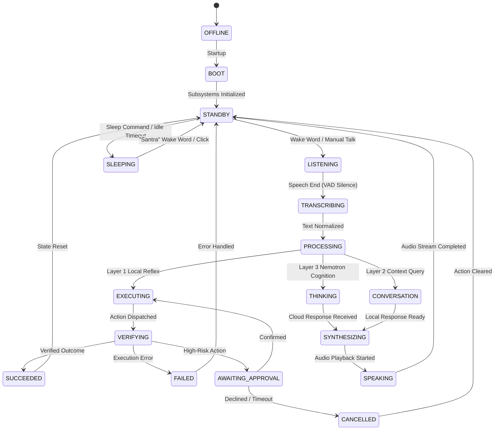

# SANTRA — SYSTEM ARCHITECTURE SPECIFICATION
## Comprehensive Architecture, Intelligence Routing, Memory, Perception & State Lifecycle

**Assistant Name:** SANTRA  
**Platform:** Windows 11 Primary (Ubuntu Compatible)  
**Language & UI:** Python 3.14 + PyQt6  
**Version:** 2.0 (Master Engineering Baseline)  

---

## 1. ARCHITECTURAL PHILOSOPHY

SANTRA is designed around three fundamental engineering principles:

1. **Local-First Determinism:** Local operations (opening applications, focusing windows, adjusting volume, taking screenshots, inspecting system telemetry) must execute with near-zero latency (<50ms) using deterministic native APIs. They must never depend on or unnecessarily invoke remote cloud LLMs.
2. **Cognitive Cloud Delegation:** Deep reasoning, algorithm synthesis, multi-turn technical explanations, and complex general knowledge are delegated to high-capacity cloud models (NVIDIA Nemotron 3.5 Super VL). Cloud output is strictly isolated from direct operating system access.
3. **Strict Safety & Transparency:** No AI response is permitted to execute arbitrary system code directly. All side-effecting operations flow through a deterministic Safety Gate requiring explicit cryptographic confirmation where appropriate.

---

## 2. THREE-LAYER INTELLIGENCE ROUTING SPECIFICATION

```
                           ┌────────────────────────────────────────┐
                           │       Incoming Voice / UI Command      │
                           └───────────────────┬────────────────────┘
                                               │
                                    ┌──────────▼──────────┐
                                    │  CommandNormalizer  │
                                    └──────────┬──────────┘
                                               │
                                    ┌──────────▼──────────┐
                                    │ IntelligenceRouter  │
                                    └──────────┬──────────┘
                                               │
               ┌───────────────────────────────┼───────────────────────────────┐
               │                               │                               │
       [Reflex / Local OS]            [Contextual / Social]           [Cognition / Planning]
               ▼                               ▼                               ▼
    ┌─────────────────────┐         ┌─────────────────────┐         ┌─────────────────────┐
    │       LAYER 1       │         │       LAYER 2       │         │       LAYER 3       │
    │   Fast Reflex Core  │         │ Context Conversation│         │  AgentBrain & Cloud │
    ├─────────────────────┤         ├─────────────────────┤         ├─────────────────────┤
    │ - Native OS Control │         │ - Topic Tracking    │         │ - Multi-Step Plans  │
    │ - App Discovery     │         │ - Pronoun Resolution│         │ - NVIDIA Nemotron   │
    │ - Browser CDP Nav   │         │ - Social Greetings  │         │ - Algorithmic QA    │
    │ - Media & Volume    │         │ - System Clock/Date │         │ - Code Synthesis    │
    │ - Window Focus/State│         │ - Offline Fallback  │         │ - Deep Document QA  │
    └──────────┬──────────┘         └──────────┬──────────┘         └──────────┬──────────┘
               │                               │                               │
               ▼                               ▼                               ▼
    ┌─────────────────────┐         ┌─────────────────────┐         ┌─────────────────────┐
    │   CommandExecutor   │         │ ConversationManager │         │ ReAct Trace Filter  │
    └─────────────────────┘         └─────────────────────┘         └─────────────────────┘
```

### Layer 1: Fast Reflex Core (Deterministic Local Execution)
- **Target Latency:** < 50ms
- **Execution Target:** Native Windows APIs (Win32, UIA, PowerShell), Browser CDP, PortAudio.
- **Scope:**
  - Application launch/close (`Chrome`, `VS Code`, `Antigravity IDE`, `Notepad`, `Spotify`).
  - Window control (minimize, maximize, focus, switch).
  - Browser navigation (open website, new tab, search Google/YouTube).
  - Hardware & system telemetry (volume, battery status, power schemes, locks).
  - Safe filesystem actions (folder creation, atomic file save).

### Layer 2: Contextual Conversation & Offline Memory
- **Target Latency:** < 100ms
- **Execution Target:** Local template engines and SQLite persistent conversation context.
- **Scope:**
  - Conversational small talk, greetings, affirmations, and etiquette.
  - Active topic preservation and pronominal reference resolution (`"it"`, `"its"`, `"re-explain"`, `"give another example"`).
  - Offline factual queries (system time, date, user profile information).
  - Graceful offline fallback when network is unavailable.

### Layer 3: Cognition, Reasoning & Multi-Step Agentic Planning
- **Target Latency:** 800ms – 2500ms
- **Execution Target:** NVIDIA Nemotron Cloud Gateway (`nvidia/nemotron-3.5-super-vl-120b-a12b`).
- **Scope:**
  - Data structures, algorithms (DSA), and programming concepts (C++, Python, MERN).
  - Multi-step compound workflows requiring decomposition.
  - Gaming analysis and theorycrafting (Valorant agent utility, Clash Royale draft synergies).
  - Technical troubleshooting and architectural comparisons.

---

## 3. UNIFIED FIVE-TIER MEMORY ARCHITECTURE

To ensure SANTRA never conflates local system targets with ongoing discussion topics, memory is structured into five isolated tiers:

```
┌────────────────────────────────────────────────────────────────────────┐
│                        SANTRA MEMORY ARCHITECTURE                      │
├────────────────────┬──────────────────────────────────┬────────────────┤
│ Memory Tier        │ Storage Engine                   │ Lifespan       │
├────────────────────┼──────────────────────────────────┼────────────────┤
│ 1. Session Memory  │ In-Memory Sliding Buffer (turns) │ Active Session │
│ 2. Topic Memory    │ ExplanationState & TaskContext   │ Across Commands│
│ 3. Command History │ SQLite (CommandHistoryService)   │ Persistent     │
│ 4. Long-Term Store │ SQLite (jarvis_memory.db)        │ Multi-Session  │
│ 5. Pending Actions │ Memory Context (PendingApproval) │ TTL (60-180s)  │
└────────────────────┴──────────────────────────────────┴────────────────┘
```

1. **Session Conversation Memory:** Rolling multi-turn buffer of raw user utterances and clean assistant responses. Trimmed to configured max turns (`max_turns=10`).
2. **Topic Memory (`ExplanationState`):** Stores the current educational topic, goal, full text, and remaining sentence list. Crucially, executing a Layer 1 command (such as `"Open Chrome"`) updates the system action target without clearing or mutating the active educational topic.
3. **Command History Service:** Dedicated SQLite log of every executed system command. Tracks command ID, normalized phrase, category, target application, execution outcome (`SUCCEEDED`, `FAILED`, `BLOCKED`, `CANCELLED`), timestamps, and verification evidence.
4. **Persistent Long-Term Memory:** Persistent key-value storage for user identity, learned preferences, discovered projects, and verified procedures.
5. **Pending-Action Memory:** Isolated state container holding unconfirmed high-risk operations (e.g. system sleep/restart, message submission) with strict TTL timeouts.

---

## 4. INTELLIGENT DESKTOP PERCEPTION & INTERACTION

Desktop perception provides reliable, coordinate-independent application control:

```
                    ┌────────────────────────────────────────┐
                    │      DesktopContextService (UIA)       │
                    └───────────────────┬────────────────────┘
                                        │
           ┌────────────────────────────┼────────────────────────────┐
           ▼                            ▼                            ▼
  [Application Resolver]       [Window Focus Detector]      [Control Introspection]
  - Discovers installed EXEs   - Inspects foreground HWND   - Identifies ControlType:
  - Resolves aliases & paths   - Detects minimized windows    • PROMPT_BOX (ChatGPT)
  - Manages process lifecycle  - Validates focus stability    • CODE_EDITOR (Antigravity)
                                                              • SEARCH_FIELD (Chrome)
                                                              • DOCUMENT (Notepad)
```

### 4.1 Target Disambiguation Protocol
1. **Single Match:** Focus control directly and begin typing.
2. **Multiple Matches:** Analyze surrounding accessibility labels. If still ambiguous, prompt the user conversationally:
   *"I found multiple input fields (Search, Message Body). Which one should I use?"*
3. **No Active Field:** Ask the user to click the intended control:
   *"Please click or focus the intended input field and tell me when you're ready."*

### 4.2 Ask-Before-Send Gated Approval
For external messaging and web forms:
1. **Draft Staging:** Text is typed into the control.
2. **Cryptographic Binding:** SHA-256 hash generated over drafted text and target window HWND.
3. **Approval Interception:**
   - Explicit confirmation phrases (`"yes send it"`, `"send"`, `"submit"`) trigger send.
   - Ambiguous phrases (`"looks good"`, `"okay"`, `"fine"`) confirm text but do NOT send.
   - Rejection phrases (`"cancel"`, `"don't send"`, `"leave it"`) cancel submission safely.

---

## 5. UNIFIED INTERACTION STATE MACHINE

SANTRA synchronizes the audio pipeline, runtime workers, and PyQt6 visual dashboard using an authoritative lifecycle:



---

## 6. CLOUD AI GATEWAY & REACT TRACE SANITIZATION

To eliminate internal trace leakage into TTS speech and conversation transcripts:

1. **Streaming Delimiter Guard:** A stream pre-processor inspects incoming token chunks before buffering sentences.
2. **Token Stripping Regex:**
   ```python
   re.sub(r"(?i)\b(?:Thought|Action|Action Input):\s*[^\n]+", "", text)
   ```
3. **Fallback Agent Synthesis:** If Nemotron emits a tool call without a `Final Answer:`, the agent executes the tool internally and synthesizes a natural confirmation:
   *"Certainly. Putting your computer into sleep mode now."*

---

## 7. TELEMETRY & OBSERVABILITY

The UI status cards reflect true runtime state:
- **Audio Telemetry:** Active recording device, active playback device, sample rate, peak RMS levels.
- **Resource Monitor:** CPU usage percentage, virtual memory consumption.
- **Live Pipeline Card:** Dynamic telemetry states:
  - `LOCAL_REFLEX` (<50ms)
  - `NEMOTRON_REQUESTING` (Socket opened)
  - `NEMOTRON_PROCESSING` (Streaming tokens)
  - `NEMOTRON_COMPLETED` (Success)
  - `PROVIDER_UNAVAILABLE` (Offline mode)
  - `ROUTING_UNRESOLVED` (Fallback error)

---

## 8. STAGE 2 ARCHITECTURE INTEGRATION & UNIFIED ROUTING AUTHORITY

### 8.1 Unified Single-Router Authority
The fractured routing behavior between legacy `core/intent_engine.py` and `core/ai/intelligence_router.py` has been consolidated. `IntelligenceRouter` is the single authoritative entry point for all command classification:
- **Reflex Classification (`LAYER_1`):** Sub-millisecond deterministic intent recognition for OS, application, media, power, and window control. Local reflex commands bypass cloud APIs completely.
- **Contextual Memory (`LAYER_2`):** Resolves anaphora and pronoun references (`"give another example"`, `"make it simpler"`, `"in C++"`) against persistent conversational state.
- **Cognitive Cloud Reasoning (`LAYER_3`):** Engages NVIDIA Nemotron for deep reasoning, multi-step algorithms, and general knowledge.

### 8.2 Explicit AI_MODE State Machine
SANTRA maintains a distinct user-controlled AI mode state machine:
- **Toggles:** Activated by `"switch to AI mode"`, `"enable AI mode"`, `"ask Nemotron"` and deactivated by `"exit AI mode"`, `"disable AI mode"`, `"return to normal mode"`.
- **Isolation Principle:** In AI Mode, local deterministic commands (`"open Chrome"`, `"volume up"`, `"mute"`) *still execute locally*, while exploratory and conversational questions route to Nemotron.
- **UI Synchronization:** Live header badge in `MainWindow` reflects the current state (`✦ AI MODE` vs `● NORMAL MODE`).

### 8.3 Decoupled Educational Context
Educational topics (e.g., algorithms, concepts) are held in `active_educational_topic` in `ConversationManager`. Intervening OS actions (`open_app`, `screenshot`, `volume`) update transient UI focus (`last_target`) without purging or polluting the educational discourse topic.

### 8.4 Output Channel & Speech Safeguards
- **ReAct Trace Stripping:** Raw reasoning markers (`Thought:`, `Action:`, `Action Input:`, `Observation:`, `Final Answer:`) are scrubbed before TTS synthesis.
- **Caption Channel Separation:** Real-time microphone transcription captions are prefixed with `Transcribing: "..."`, while assistant vocalizations use `Speaking: "..."` and distinct status indicators.

---

*Specification authored for SANTRA Architectural Baseline.*

