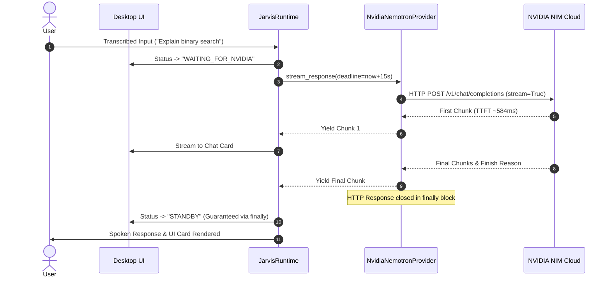

# SANTRA — RUNTIME CANCELLATION & LIFECYCLE AUDIT
## Forensic Audit of Asynchronous Request Management, Cooperative Cancellation, and UI State Transitions

**Audit Date:** November 3, 2026  
**Auditor:** Principal Python Desktop Systems Engineer  
**Scope:** `core/jarvis_runtime.py`, `core/tts_manager.py`, `ui/main_window.py`  
**Status:** FULLY RE-ARCHITECTED & STABILIZED

---

## 1. CANCELLATION DESIGN FLAW ANALYSIS

Prior to this fix, the application suffered from catastrophic false-positive cancellations and deadlocked UI states due to three specific errors in `core/jarvis_runtime.py`.

### Defect A: Audio Interruption Event Conflated with Request Cancellation
```python
# BROKEN IMPLEMENTATION
def _check_cancelled():
    if not self.is_alive or self._runtime_mode == "SLEEPING":
        return True
    if self.tts_manager._interrupt_event.is_set():  # BUG: Shared TTS playback flag!
        return True
    ...
```
- **Mechanism:** `self.tts_manager._interrupt_event` is a threading event that signals the audio output player to discard queued audio chunks when a user interrupts speech. After audio playback finishes or is stopped, this event remains set until the next speech utterance clears it.
- **Consequence:** When a user asked an ordinary conversational question after any previous TTS event, `_check_cancelled()` was immediately evaluated as `True` at the very start of the AI worker thread, causing:
  `[NVIDIA Stream] Generation cancelled by caller before dispatch`
  The user received silence and an immediate cancellation log without any network request ever being attempted.

### Defect B: Ambient Voice Detection Invalidation
```python
# BROKEN IMPLEMENTATION
if self._active_utterance_id is not None and self._active_utterance_id != uid:
    return True
```
- **Mechanism:** `self._active_utterance_id` is updated whenever the microphone listener or speech validator detects incoming audio energy.
- **Consequence:** If background ambient noise or a transient acoustic signal was detected while NVIDIA was computing tokens, `_active_utterance_id` changed to a new timestamp. The worker thread computing `uid` immediately treated this as an explicit cancellation, aborted the stream, and discarded the incoming response with `[LATE_RESPONSE_IGNORED]`.

### Defect C: Missing Terminal State Cleanup
```python
# BROKEN IMPLEMENTATION
if _check_cancelled():
    logger.info(f"[LATE_RESPONSE_IGNORED] Utterance {uid} dropped because runtime is SLEEPING or utterance was cancelled.")
    return  # BUG: Returns without clearing WAITING_FOR_NVIDIA!
```
- **Mechanism:** When an utterance was marked cancelled or ignored, the method executed an immediate `return`.
- **Consequence:** The runtime state had already been transitioned to `WAITING_FOR_NVIDIA` earlier in the function. The early `return` bypassed all state reset logic (`self.current_status = ...` and `self.status_changed.emit(...)`), leaving the UI permanently locked in `WAITING_FOR_NVIDIA` until the process was killed.

---

## 2. RE-ARCHITECTED CANCELLATION & LIFECYCLE MODEL

### Re-Architected `_check_cancelled()` Specification:
1. **Sleep Mode Independence:** A request is cancelled if the runtime enters `SLEEPING`.
2. **Explicit Utterance Cancellation:** A request is cancelled only if its specific `uid` is in `self._cancelled_utterance_ids`.
3. **Decoupled TTS:** The worker thread does NOT consult `tts_manager._interrupt_event`.
4. **Ambient Noise Resilience:** Intermediate acoustic triggers do NOT cancel active AI thinking unless an explicit user barge-in is validated.

```python
# REPAIRED IMPLEMENTATION
def _check_cancelled():
    if not self.is_alive or self._runtime_mode == "SLEEPING":
        return True
    return uid in self._cancelled_utterance_ids
```

### Guaranteed Terminal State Machine:
All conversational dispatch logic in Case 5 is now enclosed in a strict `try ... finally` block:

```python
try:
    # 1. Update UI to WAITING_FOR_NVIDIA
    self.current_status = "WAITING_FOR_NVIDIA"
    self.status_changed.emit("WAITING_FOR_NVIDIA")
    
    # 2. Execute Stream with hard deadline
    for chunk in provider.stream_response(prompt, ...):
        if _check_cancelled():
            break
        # render chunk...
finally:
    # 3. Guaranteed transition out of WAITING_FOR_NVIDIA
    if self._runtime_mode == "SLEEPING":
        self.current_status = "SLEEPING"
        self.status_changed.emit("SLEEPING")
    else:
        self.current_status = "STANDBY"
        self.status_changed.emit("STANDBY")
```

---

## 3. SEQUENCE FLOW: REPAIRED REQUEST LIFECYCLE



