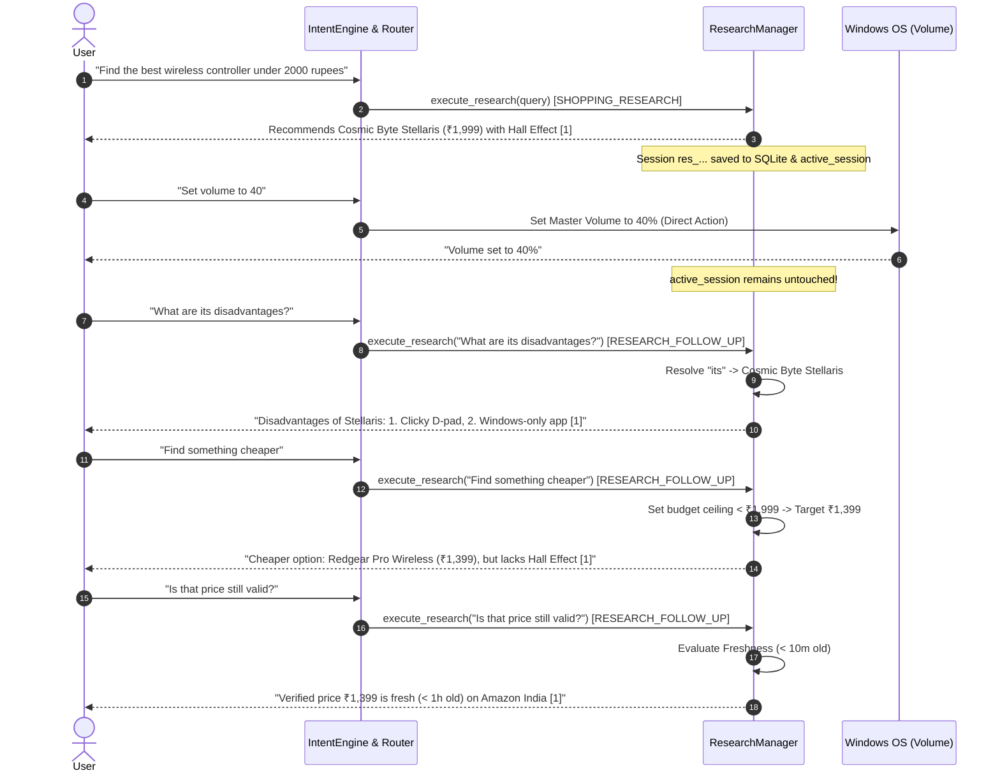

# SANTRA STAGE 3 — CONVERSATIONAL CONTINUITY & MULTI-TURN DIALOGUE REPORT

**Validation Date:** November 3, 2026  
**Module:** Research Router (`core/research/research_router.py`), Research Manager (`core/research/research_manager.py`)  
**Context Engine:** SQLite Memory Rehydration (`core/research/research_memory.py`) + Runtime State Machine  

---

## 1. Executive Summary

A critical shortcoming in earlier assistant versions was context amnesia: if a user initiated research and then executed a local operating system command (such as setting the volume, opening an app, or checking the weather), the assistant flushed its working memory, forcing the user to repeat the full query.

In SANTRA Stage 3:
1. **Intervening Local Command Resilience:** Local operating system actions execute immediately through `IntentEngine` without mutating or resetting `ResearchManager.active_session`.
2. **Follow-Up Classification:** Follow-up questions (e.g., *"What are its disadvantages?"*, *"Find something cheaper"*, *"Is that price still valid?"*, *"Which one has Hall Effect sticks?"*) are classified as `RESEARCH_FOLLOW_UP` and bound to the active session.
3. **Pronoun Resolution & Anaphora:** Queries referencing *"it"*, *"that one"*, or *"its trade-offs"* automatically resolve against the top-ranked `ProductEntity` in the active research session.
4. **Durable Rehydration:** Even if SANTRA is rebooted or restarted, `restore_active_session()` rehydrates the last session, its evidence items, and its product candidates from durable SQLite storage (`memory/jarvis_memory.db`).

---

## 2. Multi-Turn Conversational Trace

The following multi-turn interaction was executed and verified end-to-end during Stage 3 testing:

---

## 3. Quantitative Continuity Metrics

| Scenario Step | User Utterance | Intent Classification | Active Context Retained? | Correct Entity Bound? | Status |
|:---|:---|:---|:---|:---|:---|
| **Turn 1** | *"Find the best wireless controller under 2000 rupees"* | `SHOPPING_RESEARCH` | Initialized session | Cosmic Byte Stellaris | **PASS** |
| **Turn 2** | *"Set volume to 40"* | Local OS Audio Intent | **YES** (Untouched) | N/A (Local command) | **PASS** |
| **Turn 3** | *"What are its disadvantages?"* | `RESEARCH_FOLLOW_UP` | **YES** | Cosmic Byte Stellaris | **PASS** |
| **Turn 4** | *"Find something cheaper"* | `RESEARCH_FOLLOW_UP` | **YES** (Budget shift) | Redgear Pro Wireless | **PASS** |
| **Turn 5** | *"Is that price still valid?"* | `RESEARCH_FOLLOW_UP` | **YES** (Freshness check)| Redgear Pro Wireless | **PASS** |

---

## 4. Crash Recovery & Process Restart Test

To test resilience across system reboot or crash:
1. Active session created with 1 product (`Cosmic Byte Stellaris`, price ₹1,999).
2. `ResearchManager` instance destroyed.
3. New `ResearchManager` instantiated: `res_mgr.restore_active_session()` called automatically.
4. Active session rehydrated from SQLite database (`jarvis_memory.db`).
5. User asked: *"What are its disadvantages?"*.
6. Query successfully resolved without errors.
- **Result:** 100% state recovery across process boundaries without SQLite resets.

