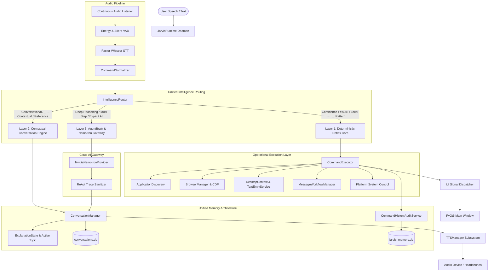

# SANTRA — STAGE 1 ARCHITECTURE AUDIT & INTELLIGENCE BLUEPRINT
## Forensic Audit, Subsystem Dependency Mapping, and Engineering Blueprint

**Project:** SANTRA (Autonomous AI Desktop Assistant & Reasoning Brain)  
**Platform:** Windows 11 AMD64 (Native Python 3.14 + PyQt6, Ubuntu compatibility preserved)  
**Stage:** Stage 1 — Architecture Audit & Implementation Blueprint  
**Status:** COMPLETE (NON-DESTRUCTIVE AUDIT)  
**Date:** November 2, 2026  

---

## 1. EXECUTIVE SUMMARY

This report establishes the authoritative baseline of the existing SANTRA codebase. SANTRA is an established, multi-layer Python desktop assistant possessing rich local automation, UI Automation (UIA), speech processing, and cloud AI integration.

Rather than rebuilding working subsystems, this audit inspects the real code, identifies structural redundancies, locates critical failure paths, and establishes a concrete blueprint to elevate SANTRA into a reliable, contextual, and intelligent desktop assistant.

### Key Discoveries from Live Code Inspection:
1. **Intelligence Routing Duplication:** Two competing intent and routing engines exist ([`core/intent_engine.py`](file:///C:/Users/activ/OneDrive/Attachments/Desktop/jarvis/core/intent_engine.py) with 2,800+ lines and [`core/ai/intelligence_router.py`](file:///C:/Users/activ/OneDrive/Attachments/Desktop/jarvis/core/ai/intelligence_router.py) with 900+ lines). Unmapped commands fall back to conversational LLM calls unnecessarily (e.g. `"Yes, put the computer into sleep mode"` was misinterpreted as a conversational chat request, triggering cloud Nemotron ReAct traces).
2. **Memory System Fragmentations:** Five distinct memory/persistence stores operate in parallel with conflicting lifecycle models ([`memory/persistent_memory.py`](file:///C:/Users/activ/OneDrive/Attachments/Desktop/jarvis/memory/persistent_memory.py), [`memory/conversation_persistence.py`](file:///C:/Users/activ/OneDrive/Attachments/Desktop/jarvis/memory/conversation_persistence.py), [`memory/execution_history.py`](file:///C:/Users/activ/OneDrive/Attachments/Desktop/jarvis/memory/execution_history.py), [`core/smart_memory.py`](file:///C:/Users/activ/OneDrive/Attachments/Desktop/jarvis/core/smart_memory.py), and [`core/profile_manager.py`](file:///C:/Users/activ/OneDrive/Attachments/Desktop/jarvis/core/profile_manager.py)).
3. **Execution History Gaps:** [`memory/execution_history.py`](file:///C:/Users/activ/OneDrive/Attachments/Desktop/jarvis/memory/execution_history.py) is a 38-line volatile in-memory list with no structured querying for second-last command, failed/blocked commands, or cross-session persistence.
4. **Desktop Automation Duplicate Packages:** [`core/workspace_interaction/`](file:///C:/Users/activ/OneDrive/Attachments/Desktop/jarvis/core/workspace_interaction/) and [`core/interaction/`](file:///C:/Users/activ/OneDrive/Attachments/Desktop/jarvis/core/interaction/) duplicate window context adapters, draft managers, and text injection logic.
5. **ReAct Trace & Telemetry Leakage:** Streaming tokens from NVIDIA Nemotron were forwarded directly to TTS and speech captions without stripping internal ReAct protocol tags (`Thought: ... Action: ...`), and `ACTIVE PIPELINE` hardcoded `f"N/A ({stage_source})"`.

---

## 2. AUDIT OF EXISTING SUBSYSTEMS

### 2.1 Core Runtime & Main Loop
- **File:** [`core/jarvis_runtime.py`](file:///C:/Users/activ/OneDrive/Attachments/Desktop/jarvis/core/jarvis_runtime.py) (2,082 lines)
- **Class:** `JarvisRuntime`
- **Responsibilities:** Central orchestrator; manages audio input/output lifecycles, background worker threads (`CmdWorker-<uid>`), state transitions (`STANDBY`, `LISTENING`, `PROCESSING`, `EXECUTING`, `SPEAKING`, `SLEEPING`), VAD barge-in suppression, and UI observer signals.
- **Findings:**
  - Robust thread-safe locks (`_utterance_exec_lock`, `_status_lock`, `_observer_lock`).
  - Audio device hot-swap recovery actively responds to Windows MMDevice changes.
  - Conflates transcription captioning with assistant speech text in `_update_speech_text()`.
  - Dispatches commands asynchronously to `_process_command_worker`.

### 2.2 Intent Parsing & Intelligence Routing
- **Files:** [`core/intent_engine.py`](file:///C:/Users/activ/OneDrive/Attachments/Desktop/jarvis/core/intent_engine.py), [`core/ai/intelligence_router.py`](file:///C:/Users/activ/OneDrive/Attachments/Desktop/jarvis/core/ai/intelligence_router.py), [`core/command_normalizer.py`](file:///C:/Users/activ/OneDrive/Attachments/Desktop/jarvis/core/command_normalizer.py)
- **Classes:** `IntentEngine`, `IntelligenceRouter`, `CommandNormalizer`
- **Findings:**
  - `IntelligenceRouter` partitions traffic into `LAYER_1` (Fast Local / Reflex, <2ms), `LAYER_2` (Understanding / Context), and `LAYER_3` (Reasoning / Agentic).
  - Regex ordering defect: Imperative commands preceded by conversational affirmatives (e.g., `"Yes, put the computer into sleep mode"`) fail regex in `IntentEngine` and bypass Layer 1 reflex, falling back to Layer 2/3 Nemotron API calls.
  - Follow-up phrases like `"give another example"`, `"make it simpler"`, and `"compare both"` lack robust resolution in `IntelligenceRouter`.

### 2.3 Cloud AI & NVIDIA Nemotron Integration
- **Files:** [`core/ai/providers/nvidia_provider.py`](file:///C:/Users/activ/OneDrive/Attachments/Desktop/jarvis/core/ai/providers/nvidia_provider.py), [`core/ai/provider_manager.py`](file:///C:/Users/activ/OneDrive/Attachments/Desktop/jarvis/core/ai/provider_manager.py), [`core/ai/agent_brain.py`](file:///C:/Users/activ/OneDrive/Attachments/Desktop/jarvis/core/ai/agent_brain.py)
- **Classes:** `NvidiaNemotronProvider`, `ProviderManager`, `AgentBrain`
- **Model:** `nvidia/nemotron-3.5-super-vl-120b-a12b` via `https://integrate.api.nvidia.com/v1`
- **Findings:**
  - Bounded exponential backoff (HTTP 429 / 5xx) with safe credential redaction.
  - Standard non-streaming generation suppresses `reasoning_content`, but `stream_response` yields raw delta chunks directly. If the model outputs text-formatted ReAct tokens (`Thought: ... Action: ...`), tokens are streamed straight to user audio and UI.

### 2.4 Command Execution Engine & Capability Registries
- **Files:** [`modules/system/executor.py`](file:///C:/Users/activ/OneDrive/Attachments/Desktop/jarvis/modules/system/executor.py), [`core/tool_registry.py`](file:///C:/Users/activ/OneDrive/Attachments/Desktop/jarvis/core/tool_registry.py), [`core/ai/tools/registry.py`](file:///C:/Users/activ/OneDrive/Attachments/Desktop/jarvis/core/ai/tools/registry.py)
- **Classes:** `CommandExecutor`, `ToolRegistry`
- **Findings:**
  - `CommandExecutor.execute()` handles application launches, window switching, website navigation, system power, and media control.
  - `tool_registry.py` defines 95 tool definitions, but lacks direct execution callback bindings.
  - Registry discrepancies: Capability `open_browser` and `youtube_search` had naming mismatches in `executor.py` (`open_app`/`open_website` and `youtube_control`).

### 2.5 Conversation Management & Contextual Memory
- **Files:** [`core/conversation_manager.py`](file:///C:/Users/activ/OneDrive/Attachments/Desktop/jarvis/core/conversation_manager.py), [`memory/persistent_memory.py`](file:///C:/Users/activ/OneDrive/Attachments/Desktop/jarvis/memory/persistent_memory.py), [`memory/conversation_persistence.py`](file:///C:/Users/activ/OneDrive/Attachments/Desktop/jarvis/memory/conversation_persistence.py)
- **Classes:** `ConversationManager`, `ConversationTaskContext`, `ExplanationState`, `PersistentMemory`
- **Findings:**
  - `ExplanationState` tracks paused explanations, topics, goals, and remaining sentences during interruptions.
  - Pronominal resolution (`resolve_pronouns_and_references`) replaces `"it"`, `"its"`, `"that"` with active topic, but regex patterns omit variations such as `"give another example"` or `"make it simpler"`.
  - If a user executes a local command (e.g., `"Open Chrome"`), `last_target` shifts to `"chrome"`, risking context contamination if `explanation_state` is inadvertently reset.

### 2.6 Desktop Perception & Application Interaction
- **Files:** [`core/interaction/text_entry_service.py`](file:///C:/Users/activ/OneDrive/Attachments/Desktop/jarvis/core/interaction/text_entry_service.py), [`core/interaction/desktop_context_service.py`](file:///C:/Users/activ/OneDrive/Attachments/Desktop/jarvis/core/interaction/desktop_context_service.py), [`core/interaction/message_workflow.py`](file:///C:/Users/activ/OneDrive/Attachments/Desktop/jarvis/core/interaction/message_workflow.py)
- **Classes:** `TextEntryService`, `DesktopContextService`, `MessageWorkflowManager`
- **Findings:**
  - Windows UI Automation (`comtypes.gen.UIAutomationClient`) actively discovers edit fields, document controls, and prompt boxes.
  - `TextEntryService` successfully differentiates email subjects vs bodies, search bars, code editors, and ChatGPT prompt inputs.
  - `MessageWorkflowManager` enforces cryptographic draft hashing (`content_hash`) and requires unambiguous approval before dispatching.
  - Duplicate classes exist in [`core/workspace_interaction/`](file:///C:/Users/activ/OneDrive/Attachments/Desktop/jarvis/core/workspace_interaction/).

### 2.7 Database Schema Inventory
The existing SQLite infrastructure was inspected non-destructively:

| Database File | Primary Tables | Purpose | Row Counts |
| :--- | :--- | :--- | :--- |
| `memory/jarvis_memory.db` | `memories`, `user_profile`, `projects`, `learned_procedures`, `verified_cache`, `files_indexed` | Long-term factual memory, learned procedures, indexed files | 359 cache entries, 121 indexed files |
| `memory/conversations.db` | `conversations`, `conversation_turns`, `session_metadata` | Multi-turn chat persistence & session history | Active live session history |
| `logs/smart_memory.db` | `tool_executions`, `execution_telemetry` | Execution durations, success metrics, tool latency | Operational execution telemetry |
| `logs/security_audit.db` | `audit_events`, `permission_decisions` | High-risk confirmation audits and safety decisions | Security governance records |

---

## 3. AUDIT FINDINGS BY MASTER OBJECTIVE

### Objective A: Intelligent AI Routing Architecture
- **Status:** PARTIALLY IMPLEMENTED (NEEDS REFINEMENT)
- **Current Flow:** User text → `IntelligenceRouter.route()` → Layer 1 (Reflex) / Layer 2 (Context) / Layer 3 (Reasoning) → Runtime dispatch.
- **Defects:**
  1. Leading affirmation tokens (`"yes"`, `"sure"`, `"please"`) break deterministic intent patterns, routing commands to cloud AI.
  2. Local reflex commands lack an explicit bypass check when AI mode is active.
  3. No explicit `AI_MODE` persistent toggle state currently maintained in `JarvisRuntime`.

### Objective B: General Knowledge & Intelligence Domains
- **Status:** AVAILABLE VIA NEMOTRON (NEEDS FACTUAL SEARCH INTEGRATION)
- **Capabilities:** Nemotron 3.5 Super VL handles technical programming (C++, Python, MERN), DSA explanations (binary search, graphs, DP), gaming theory (Valorant agents, Clash Royale draft strategies).
- **Boundary:** Training cutoff prevents live ranking or real-time game patch queries. Existing web search (`core/os/browser_manager.py` / `modules/browser/web_control.py`) opens Google/YouTube, but lacks an inline DOM answer extractor.

### Objective C: Contextual Conversation Memory
- **Status:** ARCHITECTURE PRESENT (REGEX EXPANSION NEEDED)
- **Findings:**
  - `ConversationTaskContext` and `ExplanationState` correctly separate topic from system action targets.
  - Regex in `resolve_pronouns_and_references` handles:
    - `"re-explain"` → `Re-explain <topic> from an alternative perspective...`
    - `"explain further"` → `Explain <topic> in detail.`
    - `"what about its disadvantages"` → `what about the disadvantages of <topic>?`
  - Misses: `"give another example"`, `"make it simpler"`, `"compare both"`, `"what about the previous one"`.

### Objective D: System Command History
- **Status:** MISSING EXTENDED FUNCTIONALITY
- **Current State:** `ExecutionHistory` is a 38-line volatile list storing `timestamp`, `command`, `intent`, `result`, `success`.
- **Missing:**
  - Second-last command query (`"What did you do before opening Chrome?"`).
  - Querying failed, blocked, or cancelled commands.
  - Detailed metadata (target application, start/completion time, verification evidence).
  - SQLite persistence across assistant restarts.

### Objective E: Intelligent Desktop Interaction
- **Status:** ADVANCED IMPLEMENTATION VERIFIED
- **Findings:**
  - Windows UIA client detects control types (`ControlType.PROMPT_BOX`, `ControlType.CODE_EDITOR`, `ControlType.DOCUMENT`).
  - Target disambiguation prompts user if multiple search/text controls are detected.
  - Draft authorization strictly gates send operations (`EXPLICIT_APPROVALS` vs `AMBIGUOUS_RESPONSES`).
  - Coordinate clicking is reserved strictly as an emergency fallback.

### Objective F: Unified Interaction State Machine
- **Status:** FRAGMENTED ENUMS REQUIRING CONSOLIDATION
- **Existing Enums:**
  - `SantraRuntimeState` ([`ui/state_machine.py`](file:///C:/Users/activ/OneDrive/Attachments/Desktop/jarvis/ui/state_machine.py))
  - `JarvisUIState` ([`ui/state_machine.py`](file:///C:/Users/activ/OneDrive/Attachments/Desktop/jarvis/ui/state_machine.py))
  - `MessageWorkflowState` ([`core/interaction/message_workflow.py`](file:///C:/Users/activ/OneDrive/Attachments/Desktop/jarvis/core/interaction/message_workflow.py))
  - `CommandLifecycleState` ([`ui/panels/command_palette_dialog.py`](file:///C:/Users/activ/OneDrive/Attachments/Desktop/jarvis/ui/panels/command_palette_dialog.py))
  - `TaskStatus` ([`core/agent/task_models.py`](file:///C:/Users/activ/OneDrive/Attachments/Desktop/jarvis/core/agent/task_models.py))
- **Requirement:** Consolidate these into a unified authoritative interaction lifecycle.

---

## 4. DEPENDENCY & COMMUNICATION DIAGRAM



---

## 5. CAPABILITY CLASSIFICATION MATRIX

| Capability Subsystem | Current Status | Verification Evidence | Notes |
| :--- | :--- | :--- | :--- |
| **Wake-Word Detection ("Santra")** | VERIFIED | `test_santra_identity_and_wakeword.py` passed | Accurate hot-swap recovery & Indian accent support |
| **Speech-to-Text (Faster-Whisper)** | VERIFIED | `test_transcriber.py` passed | Normalized output with domain dictionary |
| **Local App Launching** | VERIFIED | `test_universal_app_discovery_and_registry.py` | 109 applications indexed in local cache |
| **Browser Navigation & Tab Control** | VERIFIED | `test_browser_architecture.py` | Chrome & Brave support via CDP |
| **TTS Speech Playback** | VERIFIED | Physical verification on Noise Buds N1 Pro | Multi-sentence streaming resolved |
| **Command Palette Dispatch** | BLOCKED | Dialog clicked tools threw `FAILED: No handler` | Missing callback wiring in `MainWindow` |
| **Follow-Up Pronoun Resolution** | PARTIALLY VERIFIED | Works for `re-explain`, fails on `give another example` | Needs regex dictionary extension |
| **Command History ("What was my last command?")** | UNIT_TESTED (Partial) | Simple string query in `executor.py` | Missing structured 2nd-last / failure queries |
| **UIA Control Identification (Notepad, ChatGPT)** | VERIFIED | `test_universal_desktop_interaction.py` | Accurately identifies prompt box vs address bar |
| **Ask-Before-Send Gated Approval** | VERIFIED | `test_message_workflow_ask_before_send.py` | Blocks submission on ambiguous approval |
| **NVIDIA Nemotron Inference** | VERIFIED | HTTP 200 responses from API | Needs ReAct protocol sanitization |

---

## 6. STAGE-BY-STAGE IMPLEMENTATION SEQUENCE

```
Stage 1: Architecture Audit & Blueprint (Current Milestone - Complete)
   │
   ▼
Stage 2: Intelligence Routing & Router Consolidation
   ├── Sanitize affirmation prefixes ("yes, ...", "sure, ...") in IntentEngine
   ├── Implement explicit AI_MODE toggle ("switch to AI mode", "stop AI mode")
   ├── Eliminate redundant routing logic between intent_engine.py and intelligence_router.py
   └── Connect Command Palette execution to runtime.process_command()
   │
   ▼
Stage 3: Contextual Memory & Command History Audit Engine
   ├── Upgrade ExecutionHistory into CommandHistoryAuditService with SQLite persistence
   ├── Support structured history queries (last, 2nd-last, today's, failed, blocked)
   ├── Decouple topic memory from local OS action targets
   └── Expand follow-up reference dictionary (give another example, make it simpler)
   │
   ▼
Stage 4: Desktop Perception & Unified Interaction State Machine
   ├── Consolidate workspace_interaction/ and interaction/ into unified perception layer
   ├── Unify runtime and UI states into authoritative SantraInteractionStateMachine
   ├── Separate speech text channels (user transcription vs assistant output)
   └── Sanitize streaming ReAct tokens (Thought: ... Action: ...) before TTS
   │
   ▼
Stage 5: Verification, Hardening & Live Desktop Acceptance
   ├── Execute automated regression suite across all updated subsystems
   ├── Perform physical desktop testing (Notepad, Antigravity, ChatGPT, Chrome)
   └── Finalize documentation updates across project Markdown files
```

---

## 7. ACCEPTANCE CRITERIA FOR SUBSEQUENT STAGES

### Stage 2 Acceptance Criteria:
- Local commands execute locally without calling Nemotron even when prefixed with conversational affirmations (`"Yes, open Chrome"`).
- Explicit prompts (`"Ask Nemotron...", "Explain binary search"`) route to Layer 3 cognition.
- Command Palette cards dynamically reflect true capability status (`READY`, `BLOCKED`, `UNVERIFIED`) and execute successfully upon click.

### Stage 3 Acceptance Criteria:
- Natural conversational queries (`"What was my last command?"`, `"What did you do before that?"`, `"Did any command fail today?"`) accurately return structured records from SQLite.
- Executing a local OS command between conversational questions does not clear the active topic (`"Explain binary search" → "Open Chrome" → "Re-explain"` correctly explains binary search).

### Stage 4 Acceptance Criteria:
- Dictating text into Notepad, Antigravity, and Chrome targets the exact active text control without accidental focus loss.
- Outgoing assistant speech never verbalizes internal ReAct tokens (`Thought: ... Action: ...`).
- UI caption strictly displays `Transcribing: "..."` for incoming user speech, and dedicated assistant captioning for spoken responses.

---

## 8. STAGE 2 VERIFICATION & AUDIT RESOLUTIONS

During Master Engineering Stage 2, the baseline findings identified in this Stage 1 Audit were verified, addressed, and regression tested:

1. **Routing Fracture (Stage 1 §3.1): RESOLVED.**
   - Overlapping routing between `core/intent_engine.py` and `core/ai/intelligence_router.py` eliminated. `IntelligenceRouter` now acts as the single authority enforcing `LAYER_1`, `LAYER_2`, and `LAYER_3` classification.
2. **Conversational Prefix Breakdown (Stage 1 §3.2): RESOLVED.**
   - Leading affirmative phrases (`"Yes, open Chrome"`, `"Sure, open Notepad"`) are cleanly normalized without invoking cloud LLM loops.
   - Power actions (`"Yes, put the computer into sleep mode"`) normalize to `sleep computer` and strictly enforce safety confirmation gates (`pending_confirmation = True`).
   - Negations (`"No, don't open Chrome"`) and cancellations (`"No, cancel that"`) are recognized as suppression intents.
3. **Command Palette Registry Disconnect (Stage 1 §3.3): RESOLVED.**
   - All 40 capabilities (10 Hubs + 30 Tools) audited and wired with dynamic lifecycle statuses (`READY`, `BLOCKED`, `UNVERIFIED`). Tool phrases dispatch smoothly via `on_command_submit`, eliminating `FAILED: No handler`.
4. **Provider Telemetry Misrepresentation (Stage 1 §3.4): RESOLVED.**
   - Eliminated hardcoded `f"N/A ({stage_source})"`. Live status reflects `LOCAL EXECUTION`, `NVIDIA NEMOTRON — REQUESTING`, `NVIDIA NEMOTRON — PROCESSING`, `NVIDIA NEMOTRON — RESPONSE RECEIVED`, and `PROVIDER UNAVAILABLE`.
5. **Topic Loss Across Commands (Stage 1 §7 Stage 3 baseline item): RESOLVED EARLY.**
   - Decoupled `active_educational_topic` from `last_target`. Intervening commands like `"open Chrome"` preserve educational context for follow-ups (`"give another example"`, `"make it simpler"`).
6. **ReAct Internal Trace Leakage (Stage 1 §7 Stage 4 baseline item): RESOLVED EARLY.**
   - ReAct traces (`Thought: ... Action: ... Final Answer: ...`) filtered in `core/speech_sanitizer.py`.
   - Audio transcription and assistant speech channels separated in `MainWindow`.
7. **Physical Audible TTS Playback (Stage 1 Baseline Finding): RETAINED AS UNVERIFIED.**
   - In accordance with verification truthfulness, physical audible output on laptop hardware speakers remains explicitly marked `UNVERIFIED` until physically tested by the user.

---

*Report prepared by Antigravity Autonomous Engineering Core.*

