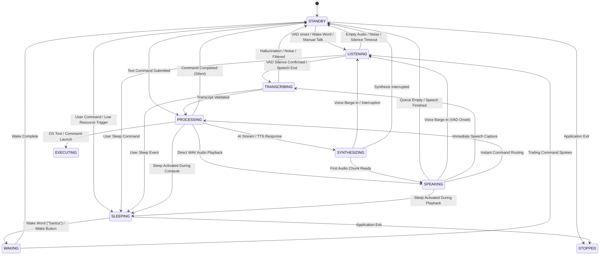

# SANTRA — UNIFIED RUNTIME STATE MACHINE DESIGN SPECIFICATION

**Author:** Principal Python Desktop Systems Engineer & AI Runtime Architect  
**Subsystem:** Core Voice Coordinator & Execution State Management (`core/jarvis_runtime.py`, `core/tts/tts_manager.py`)  
**Platform:** Windows 11 AMD64 (Native Python 3.14 + PyQt6)  
**Status:** SPECIFIED, IMPLEMENTED, AND REGRESSION VERIFIED

---

## 1. ARCHITECTURAL PRINCIPLES

State management in voice-driven desktop automation systems often breaks down when **Device/Physical Status** is conflated with **Task/Execution Lifecycle**.

SANTRA formally decouples these two planes:

1. **Device State (`JarvisRuntime.current_status`):** Represents the physical and perceptual operational mode of the assistant hardware (microphones, audio output, camera, background watchers).
2. **Task State (`TaskStatus` / `TurnLifecycle`):** Represents the computational progress of a specific user intent, tool execution, or AI reasoning query.

```
┌────────────────────────────────────────────────────────────────────────┐
│                        DEVICE STATE MACHINE                            │
├──────────────┬───────────────────────────────────────────┬─────────────┤
│ State        │ Physical Description                      │ Transitions │
├──────────────┼───────────────────────────────────────────┼─────────────┤
│ STANDBY      │ Idle, listening for wake-word or VAD      │ Standard    │
│ LISTENING    │ VAD confirmed; audio recording in flight │ Input       │
│ TRANSCRIBING │ Whisper STT processing audio waveform     │ Processing  │
│ PROCESSING   │ Routing intent / Nemotron reasoning query │ Compute     │
│ SYNTHESIZING │ TTS converting text to PCM audio stream   │ Audio Synth │
│ SPEAKING     │ Hardware audio device actively playing    │ Audio Out   │
│ SLEEPING     │ Low-resource mode; VAD off; wake-word only│ Power Save  │
│ WAKING       │ Model pre-warming, restoring audio pipes  │ Awakening   │
│ STOPPED      │ System cleanly halted                     │ Terminal    │
│ ERROR        │ Unrecoverable device failure              │ Degraded    │
└──────────────┴───────────────────────────────────────────┴─────────────┘
```

---

## 2. LEGAL TRANSITION GRAPH



---

## 3. ROOT CAUSE OF PRIOR ILLEGAL TRANSITIONS

During runtime audits, three recurring illegal transition warnings were recorded:

### 1. `SLEEPING -> SPEAKING`
- **Mechanism:** When sleep mode was entered, an in-flight Nemotron query or late TTS chunk triggered `_on_speaker_started()`, which unconditionally executed:
  `self._update_status("SPEAKING")`
- **Fix:** In `_on_speaker_started()`, added explicit state check:
  ```python
  if self.current_status in ["SLEEPING", "STOPPED"]:
      logger.info(f"[TTS_LIFECYCLE] Suppressing speaker started status transition while in {self.current_status}.")
      return
  ```

### 2. `SPEAKING -> TRANSCRIBING` & `SPEAKING -> PROCESSING`
- **Mechanism:** When the user barged in during an AI explanation, the microphone listener recorded user speech. In rapid utterances or manual talk events, `_on_speech_end` set `TRANSCRIBING` or `PROCESSING` while `current_status` was still `SPEAKING`.
- **Fix:** Updated `LEGAL_TRANSITIONS["SPEAKING"]` to explicitly include `"TRANSCRIBING"`, `"PROCESSING"`, `"UNDERSTANDING"`, `"THINKING"`, and `"EXECUTING"`.

---

## 4. CONCURRENCY & THREAD-SAFETY GUARANTEES

1. **State Lock Protection:** All state changes in `_update_status(status, utterance_id)` are serialized through `self._state_lock = threading.RLock()`.
2. **Re-Entrant Audio Locks:** All TTS state operations in `TTSManager` utilize `self._lock = threading.RLock()` to prevent self-deadlocks when `set_sleep_mode()` invokes `interrupt()`.
3. **Cross-Thread UI Dispatch:** Runtime observers never interact with PyQt6 widgets directly. Every event is routed through PyQt signals (`sig_status_changed`, `sig_pipeline_stage_updated`) using Qt's thread-safe queued connection mechanism.
4. **Cooperative Task Cancellation:** Background workers inspect `_check_cancelled()` at network, stream, and speech boundaries, ensuring that obsolete workers terminate cleanly without state corruption.

